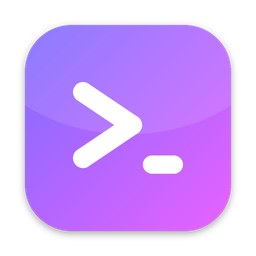
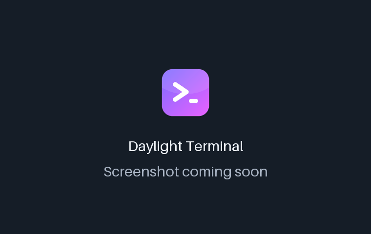
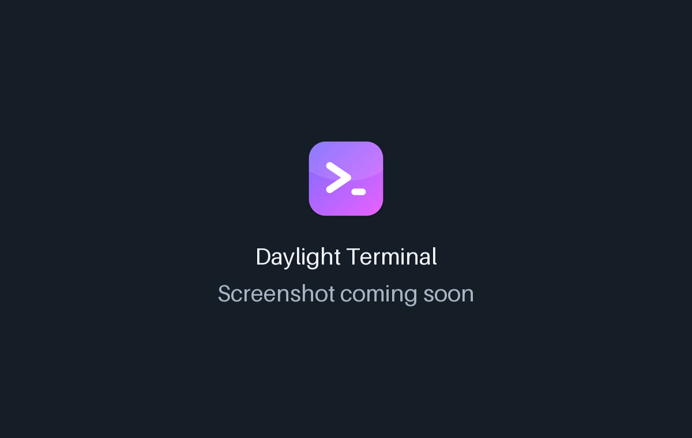

<!-- From jejezz/application-release-templates common/tool/readme @ conventions-v1.
     tool/readme/init_readme.py가 만든 파일입니다 — conventions/readme-guide.md 참고.
     {{TODO: …}}를 모두 채우십시오. 하나라도 남아 있으면 tool/readme/check_readme.py가 실패합니다. -->

<p align="center">
  
</p>

<h1 align="center">Daylight Terminal</h1>

<p align="center">
  <b>SSH 터미널과 SFTP 파일 탐색기를 한 창에서</b> — 연결 하나로 셸과 파일 탐색기를 나란히 보고, 끌어다 놓아 파일을 주고받습니다.
</p>

<p align="center">
  <a href="https://github.com/jejezz/daylight-terminal-flutter/releases/latest"></a>
  <a href="https://github.com/jejezz/daylight-terminal-flutter/releases"></a>
  
  
  <a href="LICENSE"></a>
</p>

<p align="center">
  <a href="README.md">English</a> · <b>한국어</b>
</p>

<p align="center">
  
</p>

## 기능

- **창 하나, 연결 하나** — 터미널과 SFTP 탐색기를 나란히 놓고 하나의 SSH 로그인을 함께 쓰며, 탭으로 여러 서버를 다룹니다.
- **양방향 드래그 앤 드롭** — 파일·폴더를 탐색기에 끌어다 놓으면 업로드, Finder·탐색기로 끌어내면 다운로드(여러 개 동시).
- **로컬 셸도 한 곳에서** — PowerShell, cmd, Git Bash, WSL, zsh, bash를 탭으로 열고 왼쪽에는 이 PC의 폴더를 보여 줍니다. SSH 탭과 나란히 씁니다.
- **주소록과 터미널 도구** — 그룹·검색이 되는 접속 주소록, 한 줄씩 보내는 LineSender, 세션 기록, 내장 Nerd Font(또는 설치된 아무 글꼴).
- **라이트·다크, 한국어·English** — 시스템 설정을 따르거나 툴바에서 고를 수 있습니다

<p align="center">
  
  
</p>

## 설치

[**Releases**](https://github.com/jejezz/daylight-terminal-flutter/releases/latest)에서 받습니다.

| OS | 파일 |
|---|---|
| macOS 12.0 이상 | `DaylightTerminal-<버전>-macos-universal.dmg` — 열어서 앱을 Applications 폴더로 끌어다 놓으세요 |
| Windows 10/11 (x64) | `DaylightTerminal-<버전>-windows-x64-setup.exe` |
| Linux (x64) | `DaylightTerminal-<버전>-linux-x64.tar.gz` — 압축을 풀고 `./install.sh` 실행 (`--remove`로 제거) |

**Windows:** 설치 프로그램에 아직 코드 서명이 없어서 SmartScreen이 "Windows의 PC 보호" 창을 띄웁니다. **추가 정보 → 실행**을 누르세요.

## 동작 방식

{{TODO: 궁금한 사람을 위한 2~4문장 — 흥미로운 기술적 선택 한 가지. 말할 것이 없으면 이 절을 지웁니다.}}

## 개발

```bash
flutter pub get
flutter run -d macos
```

{{TODO: 빌드에 더 필요한 것(네이티브 도구, 환경 변수). 구조 문서 링크: [ARCHITECTURE.md](ARCHITECTURE.md), [UI_UX.md](UI_UX.md).}}

릴리스: `scripts/bump-version.sh patch` → 병합 → `vX.Y.Z` 태그. CI가 모든 플랫폼을 빌드해서 올립니다. 규칙: [application-release-templates/conventions](https://github.com/jejezz/application-release-templates/tree/main/conventions).

## 크레딧

- 글꼴: [서울남산체](https://www.seoul.go.kr/seoul/font.do) (서울특별시)
- 아이콘: [Icons8](https://icons8.com)

## 라이선스

[MIT](LICENSE) © 2026 Jongyun Ahn
